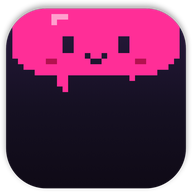
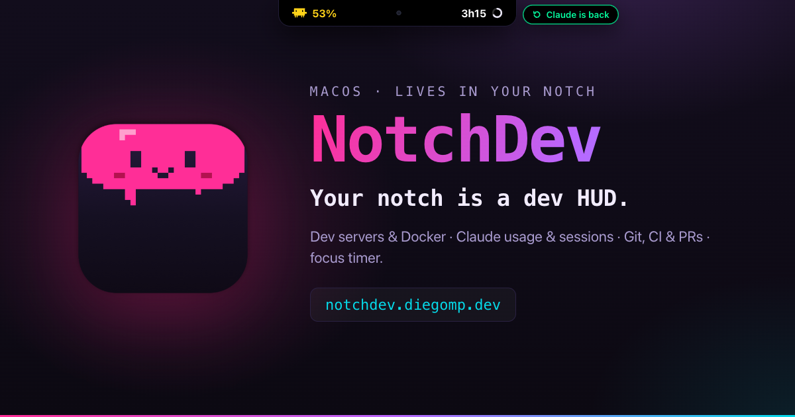
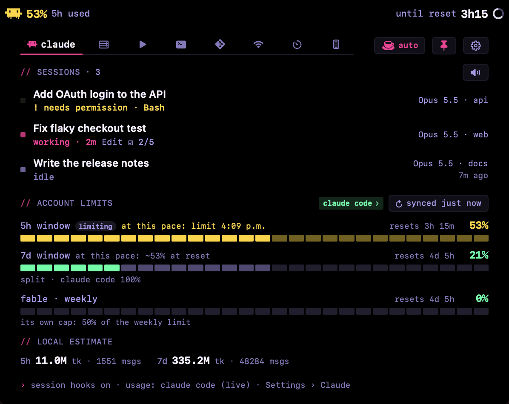

  

<h1 align="center">NotchDev</h1>

  <b>Your MacBook notch, now a dev HUD.</b> 
  Claude Code usage and sessions, dev servers, Git &amp; CI, Docker and a focus timer — one look up.

  <a href="https://notchdev.diegomp.dev"><b>Website</b></a> ·
  <a href="https://api.notchdev.diegomp.dev/api/dl"><b>Download for macOS</b></a> ·
  <a href="https://notchdev.diegomp.dev/changelog.html">Changelog</a> ·
  <a href="https://notchdev.diegomp.dev/es/">Español</a>

> This repository is for **bug reports, ideas and discussions**. NotchDev itself is closed source.

## What it does

| | |
|---|---|
| **Claude Code usage** | 5-hour and weekly limits, model caps like Fable, time to reset and a pace warning — asked from your own Claude Code, no Keychain prompt. |
| **Claude Code sessions** | Optional hooks show what every session is doing — thinking, working, needs you, done — and the notch lights up when one needs your permission. |
| **Dev servers & Docker** | Every listening dev server (Vite, Next, Expo, Node, Python…) with uptime, CPU and RAM; a two-click kill, LAN QR and ngrok tunnels. Docker containers too. |
| **Git, CI & PRs** | Per-repo status, GitHub Actions, the reviews waiting on you and your own pull requests. |
| **And more** | Network tools, package.json scripts, SSH hosts, Android mirroring, a focus timer, keep-awake while Claude works, 8 themes, a global shortcut. |

## Free and Pro

NotchDev is **free to use**. New installs get a **7-day Pro trial**; **Pro is $14.99/year** and adds live Claude Code sessions, Git/CI/PRs, Docker, tunnels, Auto ears, every theme and more. Requires **macOS 15+**.

## Install

1. [Download NotchDev.dmg](https://api.notchdev.diegomp.dev/api/dl), open it and drag NotchDev into Applications.
2. NotchDev isn't notarized by Apple yet: on first launch go to **System Settings › Privacy & Security** and click **Open Anyway**.
3. It lives in the notch — no Dock icon. Updates install from inside the app.

## Feedback

- **Found a bug?** [Open a bug report](https://github.com/diemunoz/notchdev/issues/new?template=bug.yml). In NotchDev, *Settings › General › Save diagnostics…* creates a redacted report (no prompts, paths, keys or tokens) you can attach.
- **Have an idea?** [Suggest it](https://github.com/diemunoz/notchdev/issues/new?template=idea.yml).
- **Questions, tips, show-and-tell?** Use [Discussions](https://github.com/diemunoz/notchdev/discussions) — other users can help too.

NotchDev is made by one person. I read everything, but I can't promise an answer to every issue; fixes ship in the [changelog](https://notchdev.diegomp.dev/changelog.html).

## Privacy

No account, no prompts or code ever leave your Mac, and NotchDev never reads your Keychain. See the [privacy policy](https://notchdev.diegomp.dev/privacy.html).
